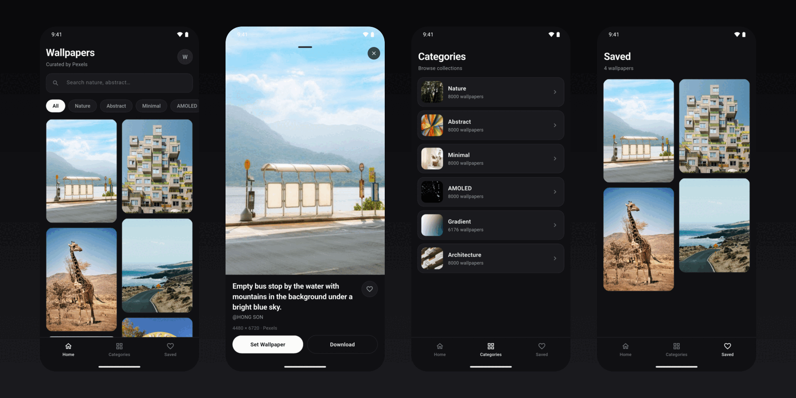
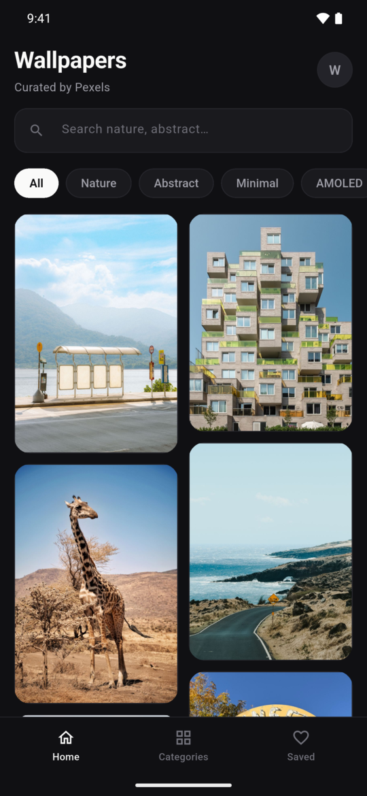
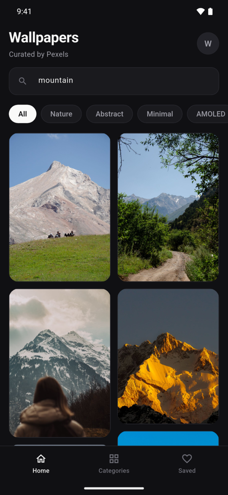
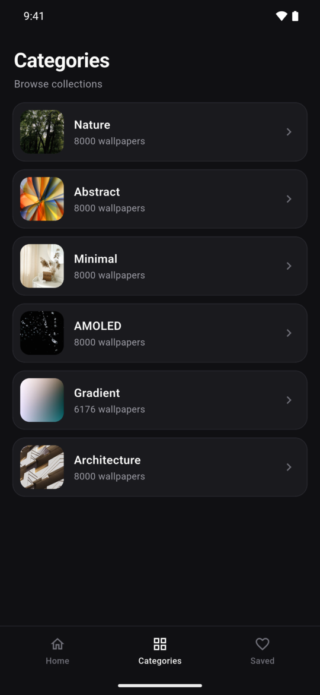
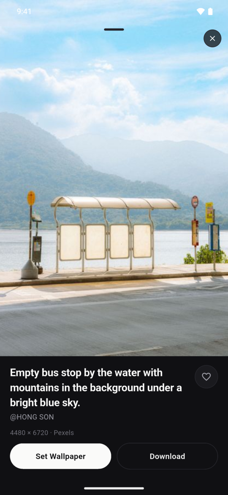
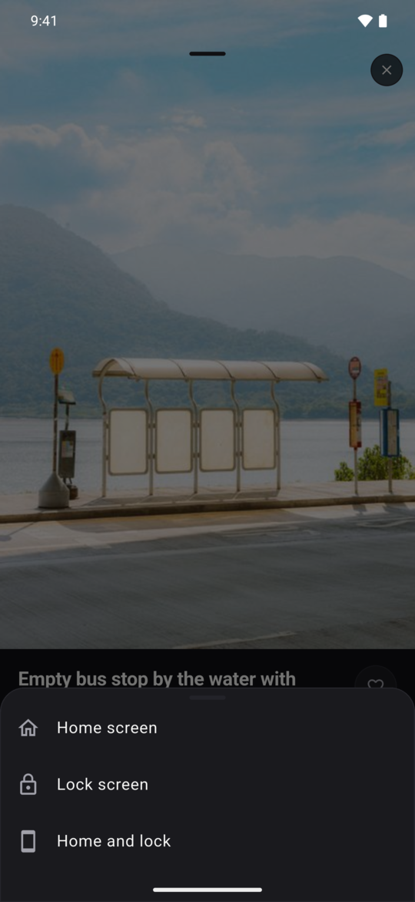
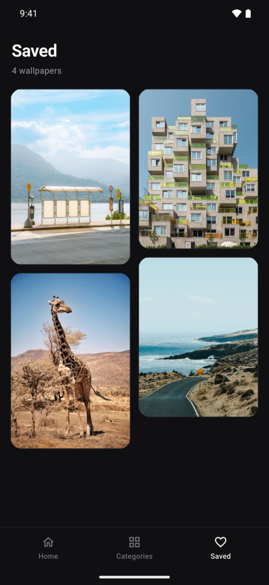
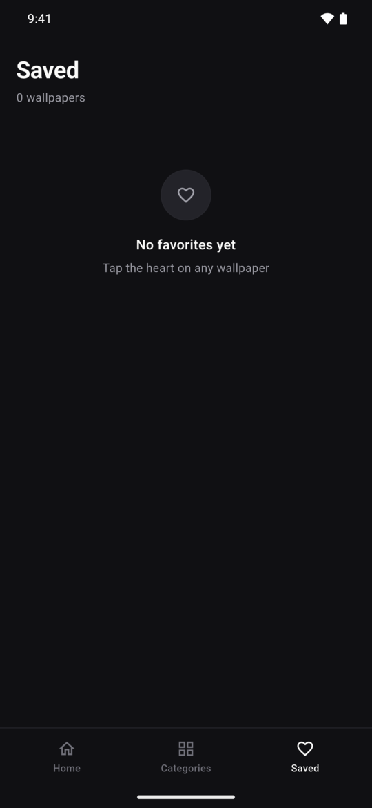
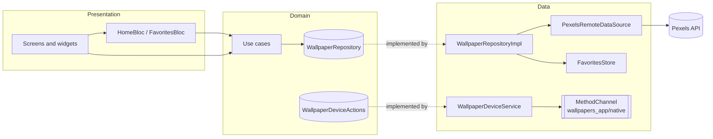

<div align="center">

# Wallpapers

**A curated wallpaper browser with a quiet, dark, grayscale design.**
Discover photos from Pexels, save your favorites, and set them as your home or lock screen in two taps.

[](https://flutter.dev)
[](https://dart.dev)
[](https://bloclibrary.dev)
[](https://www.pexels.com/api/)
[](#platform-support)
[](#testing)

<br />



</div>

<br />

## Screenshots

<table>
  <tr>
    <td align="center" width="33%">
      <br />
      <b>Home</b><br />
      <sub>Masonry grid, search and category chips</sub>
    </td>
    <td align="center" width="33%">
      <br />
      <b>Live search</b><br />
      <sub>Results update as you type</sub>
    </td>
    <td align="center" width="33%">
      <br />
      <b>Categories</b><br />
      <sub>Collections with live counts and thumbnails</sub>
    </td>
  </tr>
  <tr>
    <td align="center" width="33%">
      <br />
      <b>Detail</b><br />
      <sub>Pinch-zoom preview, photographer and resolution</sub>
    </td>
    <td align="center" width="33%">
      <br />
      <b>Set wallpaper</b><br />
      <sub>Home, lock, or both</sub>
    </td>
    <td align="center" width="33%">
      <br />
      <b>Saved</b><br />
      <sub>Your favorites in one place</sub>
    </td>
  </tr>
  <tr>
    <td align="center" colspan="3">
      <br />
      <b>Empty state</b><br />
      <sub>A friendly nudge before you've saved anything</sub>
    </td>
  </tr>
</table>

<sub>Captured on a Pixel 7 Pro emulator running the real app against the live Pexels API.</sub>

## Features

- **Masonry browsing**: a staggered two-column grid of curated, portrait-oriented photos with infinite scroll.
- **Live search**: type to search all of Pexels, with a friendly empty state when nothing matches.
- **Category chips and collections**: Nature, Abstract, Minimal, AMOLED, Gradient, and Architecture. Chips combine with search, and the Categories tab shows live photo counts.
- **Immersive detail view**: full-screen preview with pinch-zoom (up to 4×), swipe-down to dismiss, the photographer's name, and the original resolution.
- **Set as wallpaper**: choose **Home screen**, **Lock screen**, or **Home and lock** (Android).
- **Download**: save any photo straight to your gallery.
- **Favorites**: tap the heart to collect wallpapers in the Saved tab.
- **Graceful failure**: skeleton loaders, offline and error states with retry, and a neutral gradient when an image can't load.
- **Quiet design**: a zinc-gray, dark-only palette so the photos are the only color on screen.

## Architecture

The app follows a layered, clean-architecture structure. The UI never talks to the network directly, and the domain layer has no Flutter or HTTP dependencies.



Dependencies are constructor-injected into the root `WallpapersApp` widget, so tests can swap in fakes without touching production wiring.

### Project structure

```text
lib/
├── core/
│   ├── error/            # AppFailure hierarchy
│   └── theme/            # Zinc color palette and dark ThemeData
├── data/
│   ├── datasources/      # Pexels REST client
│   ├── models/           # JSON → entity mapping
│   ├── repositories/     # WallpaperRepository implementation
│   ├── services/         # Download + native channel bridge
│   └── stores/           # In-memory favorites
├── domain/
│   ├── device/           # Set-wallpaper / save-to-gallery contract
│   ├── entities/         # Wallpaper, WallpaperCategory, CategoryInfo
│   ├── repositories/     # Repository contract
│   └── usecases/         # GetWallpapers, SearchWallpapers, ToggleFavorite, …
├── presentation/
│   ├── bloc/             # Home and Favorites BLoCs
│   ├── detail/           # Full-screen wallpaper detail
│   ├── screens/          # App shell, Home, Categories, Favorites
│   └── widgets/          # WallpaperCard, SearchField, EmptyState
└── main.dart
```

### Tech stack

| Concern | Choice |
| --- | --- |
| Framework | [Flutter](https://flutter.dev) (Material 3, dark theme) |
| State management | [`flutter_bloc`](https://pub.dev/packages/flutter_bloc) + [`equatable`](https://pub.dev/packages/equatable) |
| Layout | [`flutter_staggered_grid_view`](https://pub.dev/packages/flutter_staggered_grid_view) |
| Networking | [`http`](https://pub.dev/packages/http) |
| Photos | [Pexels API](https://www.pexels.com/api/) |
| Device actions | Platform channel (Kotlin on Android, Swift on iOS) |

## Getting started

### Prerequisites

- [Flutter](https://docs.flutter.dev/get-started/install) 3.47 or newer (Dart 3.13)
- An Android emulator or device, or an iOS simulator or device
- A free [Pexels API key](https://www.pexels.com/api/)

### Run it

```bash
git clone https://github.com/MohamedRamadan222/wallpapers_app.git
cd wallpapers_app
flutter pub get
flutter run --dart-define=PEXELS_API_KEY=your_pexels_key
```

The key is compiled in at build time with `--dart-define`, so it never needs to live in source control. Without it, the app shows a "Missing Pexels API key" message instead of photos.

To build a release APK:

```bash
flutter build apk --release --dart-define=PEXELS_API_KEY=your_pexels_key
```

> **Tip:** in VS Code or Android Studio, add `--dart-define=PEXELS_API_KEY=...` to your run configuration's additional arguments.

## Platform support

| Feature | Android | iOS |
| --- | :---: | :---: |
| Browse, search, categories, favorites | ✅ | ✅ |
| Download to gallery | ✅ | ✅ |
| Set as home / lock wallpaper | ✅ | ➖ iOS doesn't let apps change the wallpaper. The app explains this and suggests setting it from Photos. |

## Testing

```bash
flutter test      # 22 unit and widget tests
flutter analyze
```

The suite covers the Pexels repository, the device-action service (with a mocked `MethodChannel`), and end-to-end widget flows: loading the catalog, search and empty results, category filtering, the detail sheet, swipe-to-dismiss, favoriting, and pagination. A fake Pexels HTTP client keeps the tests offline and deterministic.

## Credits

All photos are provided by [Pexels](https://www.pexels.com) and belong to their photographers, who are credited in each wallpaper's detail view. This app is not affiliated with Pexels.
